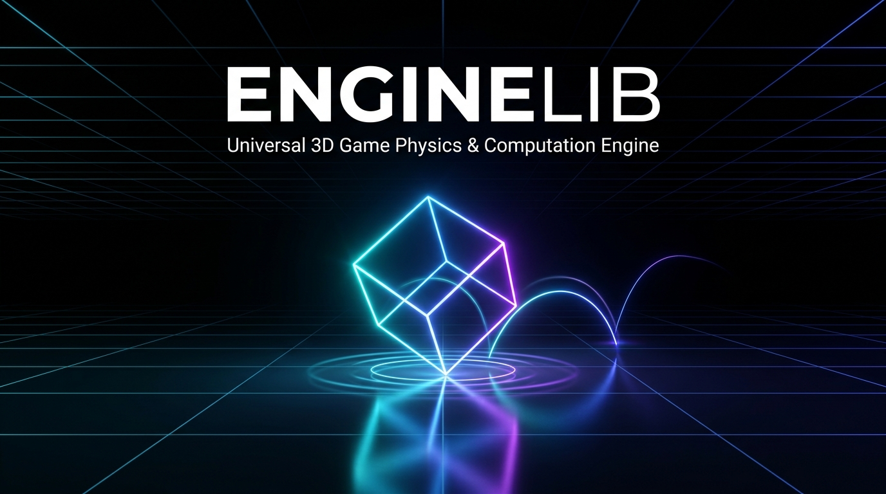
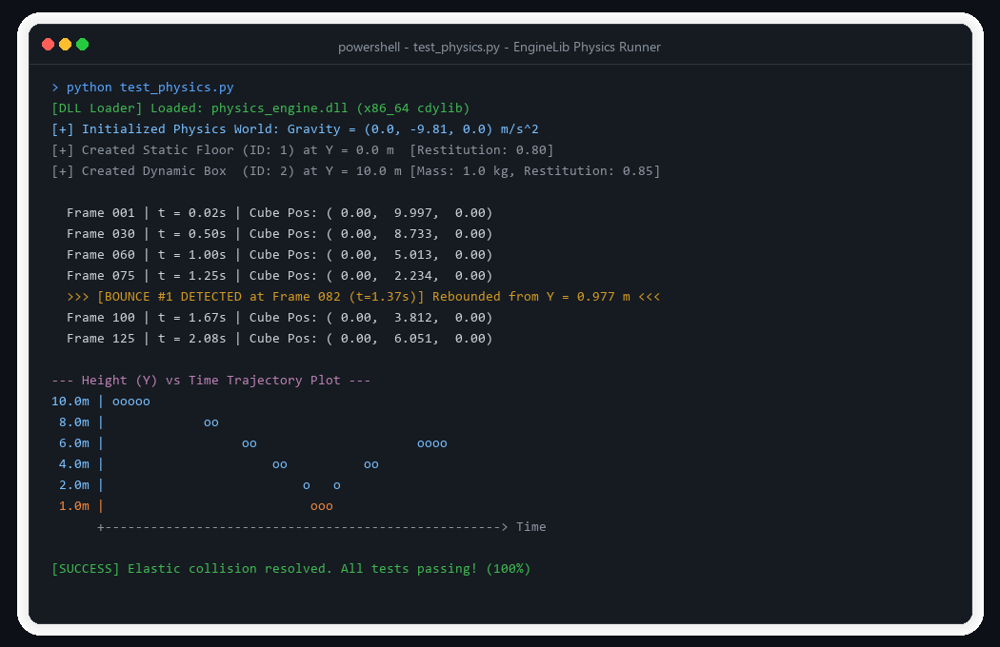

<div align="center">

  

  # EngineLib ⚡

  **Universal Cross-Language 3D Game Physics & Spatial Computation Suite**

  *A high-performance, headless computational server written in safe Rust with a zero-overhead C-ABI (FFI).*

  <p align="center">
    <a href="https://github.com/HaxOrWot/EngineLib"></a>
    <a href="https://github.com/HaxOrWot/EngineLib"></a>
    <a href="https://github.com/HaxOrWot/EngineLib"></a>
    <a href="https://github.com/HaxOrWot/EngineLib"></a>
    <a href="https://github.com/HaxOrWot/EngineLib"></a>
  </p>

  <p align="center">
    <a href="#-key-features">Key Features</a> •
    <a href="#-architecture--topology">Architecture</a> •
    <a href="#-live-simulation-preview">Preview</a> •
    <a href="#-supported-languages">Languages</a> •
    <a href="#-quick-start">Quick Start</a> •
    <a href="#-author">Author</a>
  </p>

</div>

---

## 💡 Overview

**EngineLib** decouples physical simulation mathematics and collision queries from graphic rendering pipelines. Compiled as a universal dynamic shared library (`.dll`, `.so`, `.dylib`), it acts as a **pure state & mathematics server** in native heap memory.

High-level runtimes like **Python, C# (Unity / Godot), Java**, or native **C / C++** pass kinematic inputs ($\Delta t$, forces), while EngineLib advances physics at microsecond speeds and streams back transform matrices with near-zero marshaling cost.

---

## ✨ Key Features

- **⚡ Symplectic (Semi-Implicit) Euler**: Energy-conserving numerical integration preserving phase-space volume over discrete time.
- **🛡️ 100% Panic Boundary Safety**: Every exported C-function wraps execution in `std::panic::catch_unwind`, preventing fatal cross-boundary stack unwinds.
- **📦 64-Byte Cache Aligned**: `RigidBody3D` fits into a single CPU L1 cache line, preventing false sharing and maximizing memory throughput.
- **🛑 Zero Floor Penetration**: Baumgarte positional stabilization with $5\text{ mm}$ penetration slop completely eliminates ground sinking and jitter.
- **🎯 Anti-Microbounce Damping**: Automatically cancels restitution velocity when relative impact speed drops below $0.30\text{ m/s}$.
- **🌐 Zero Runtime Dependencies**: Compiles directly against the standard library for instant compilation and lightweight binaries (< 900 KB).

---

## 📸 Live Simulation Preview

EngineLib includes standalone validation harnesses across Python, C, and C++. Below is an interactive execution of the Python `ctypes` test harness:

<div align="center">
  
  <p><em>Real-time ASCII trajectory visualization of an elastic cube rebounding off the ground under Earth gravity.</em></p>
</div>

---

## 🏛️ Architecture & Topology

```
+-------------------------------------------------------------+
|               Host Runtime (Client Environment)             |
|          Python (ctypes) | C# (.NET/Unity) | C++ / Java     |
+-------------------------------------------------------------+
                              │
                    C-Compatible ABI (FFI)
           (Pointers, Primitives, Fixed Memory Layouts)
                              │
                              ▼
+-------------------------------------------------------------+
|             Universal Rust Physics Engine (.DLL)            |
|                                                             |
|   ┌─────────────────────────────────────────────────────┐   |
|   │ 1. FFI Boundary Layer (catch_unwind, Pointer Guard) │   |
|   ├─────────────────────────────────────────────────────┤   |
|   │ 2. World State Manager (Thread-Safe Mutex / Bodies) │   |
|   ├─────────────────────────────────────────────────────┤   |
|   │ 3. Integrator (Semi-Implicit Symplectic Euler)      │   |
|   ├─────────────────────────────────────────────────────┤   |
|   │ 4. Collision Detection (3D AABB Overlap & Min-Pen)  │   |
|   ├─────────────────────────────────────────────────────┤   |
|   │ 5. Contact Solver (Baumgarte Correction + Impulses) │   |
|   └─────────────────────────────────────────────────────┘   |
+-------------------------------------------------------------+
```

---

## 💻 Supported Languages & Usage

<details open>
<summary><b>🐍 Python (via <code>ctypes</code>)</b></summary>

```python
import ctypes
from ctypes import c_float, c_uint32, Structure, byref, POINTER

# Load dynamic library
physics = ctypes.CDLL("./physics_engine.dll")

# Initialize world with Earth gravity (-9.81 m/s^2 on Y)
physics.init_physics_world(c_float(0.0), c_float(-9.81), c_float(0.0))

# Spawn floor (mass 0 = static terrain) & falling cube (mass 1.0kg)
floor_id = physics.add_rigid_body(0.0, 0.0, 0.0, 30.0, 1.0, 30.0, 0.0, 0.8)
box_id   = physics.add_rigid_body(0.0, 10.0, 0.0, 1.0, 1.0, 1.0, 1.0, 0.85)

# Step physics at 60 Hz
physics.step_physics(c_float(1.0 / 60.0))
```
</details>

<details>
<summary><b>🛡️ Modern C++ (RAII Wrapper)</b></summary>

```cpp
#include "physics_engine.hpp"

// Automatic RAII world initialization & teardown
Physics::World world(0.0f, -9.81f, 0.0f);

// Add static terrain & dynamic actors
uint32_t floor = world.addBody({0.0f, 0.0f, 0.0f}, {30.0f, 1.0f, 30.0f}, 0.0f);
uint32_t cube  = world.addBody({0.0f, 10.0f, 0.0f}, {1.0f, 1.0f, 1.0f}, 1.0f, 0.85f);

// Step simulation frame
world.step(1.0f / 60.0f);
auto position = world.getPosition(cube);
```
</details>

<details>
<summary><b>🎮 C# / Unity / Godot</b></summary>

```csharp
[DllImport("physics_engine", CallingConvention = CallingConvention.Cdecl)]
public static extern void init_physics_world(float gx, float gy, float gz);

[DllImport("physics_engine", CallingConvention = CallingConvention.Cdecl)]
public static extern uint add_rigid_body(float px, float py, float pz, float sx, float sy, float sz, float mass, float restitution);

[DllImport("physics_engine", CallingConvention = CallingConvention.Cdecl)]
public static extern void step_physics(float dt);
```
</details>

---

## 🛠️ Quick Start

### 1. Build the Release Dynamic Library
```powershell
cd PhysicsEngine
cargo build --release
```
Outputs `PhysicsEngine/target/release/physics_engine.dll` (or `.so` / `.dylib`).

### 2. Run Test Suites
```powershell
# Run native Rust unit & integration tests
cargo test

# Run multi-language integration samples (Python, C, C++)
cd "../SampleTest"
.\run_all.bat
```

---

## 👤 Author

<div align="center">
  <a href="https://github.com/HaxOrWot">
    
  </a>
  <br />
  <strong>notphoenixx</strong> (@HaxOrWot)
  <br />
  <a href="https://github.com/HaxOrWot"></a>
</div>

---

## 📄 License

This project is licensed under the **MIT License** - see the [LICENSE](LICENSE) file for details.
