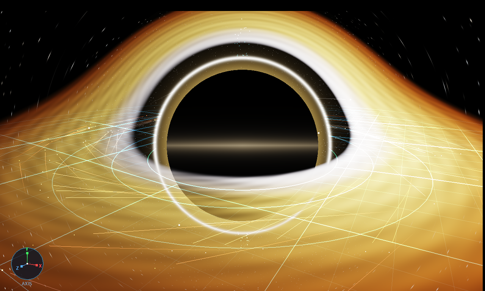
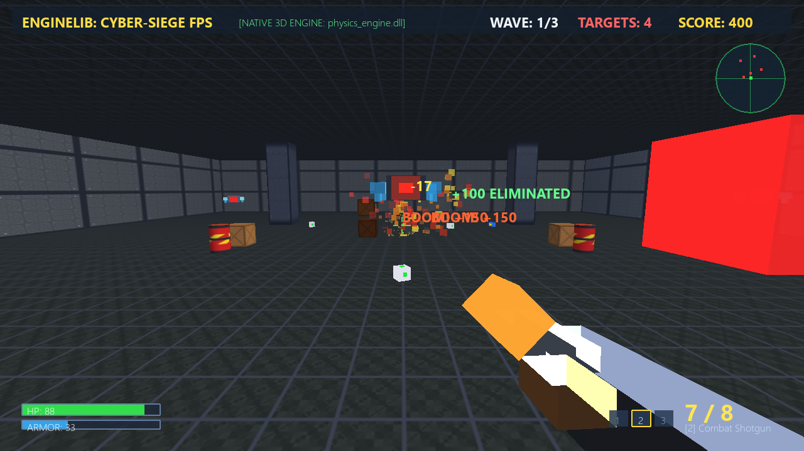
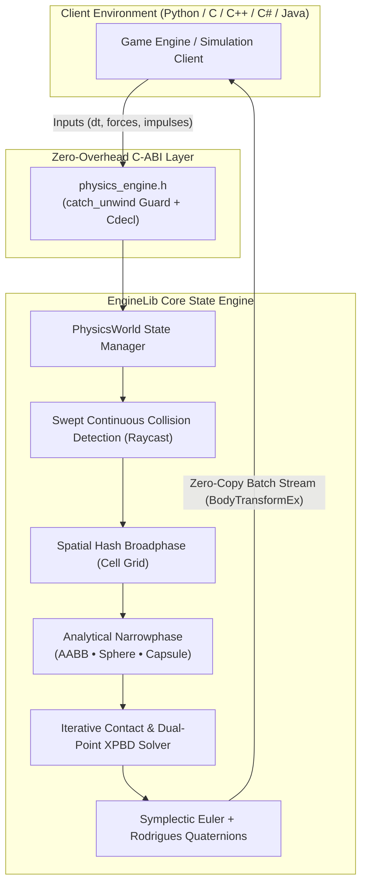

<div align="center">

  

  # ⚡ EngineLib
  ### **Universal Cross-Language 3D Game Physics & Spatial Computation Suite**

  *A deterministic, ultra-lightweight, headless computational physics engine written in safe Rust with a zero-overhead C-ABI (FFI).*

  <p align="center">
    <a href="https://github.com/HaxOrWot/EngineLib/releases/tag/v0.4.0"></a>
    <a href="https://github.com/HaxOrWot/EngineLib"></a>
    <a href="https://github.com/HaxOrWot/EngineLib/blob/main/LICENSE"></a>
    <a href="https://github.com/HaxOrWot/EngineLib"></a>
    <a href="https://github.com/HaxOrWot/EngineLib"></a>
    <a href="https://github.com/HaxOrWot/EngineLib"></a>
  </p>

  <p align="center">
    <a href="#-overview">Overview</a> •
    <a href="#-visual-showcase">Showcase</a> •
    <a href="#-v040-key-features">Key Features</a> •
    <a href="#-architectural-pipeline">Architecture</a> •
    <a href="#-c-abi-data-layouts--api">C-ABI Specs</a> •
    <a href="#-language-bindings">Languages</a> •
    <a href="#-build--quick-start">Quick Start</a> •
    <a href="#-author">Author</a>
  </p>

</div>

---

## 💡 Overview

**EngineLib** decouples complex physical simulation mathematics and geometric collision queries from graphics pipelines. Compiled as a standalone native shared library (`physics_engine.dll` on Windows, `libphysics_engine.so` on Linux, `libphysics_engine.dylib` on macOS), it runs as an **in-memory physical state server**.

```
Host Language (Python / C / C++ / C# / Java / Rust)
          │
          │  Zero-Overhead C-ABI Call (Direct Function Pointer)
          ▼
EngineLib (physics_engine.dll)
  ├── Symplectic Numerical Integrator
  ├── Drift-Free Rodrigues Exponential Quaternion Dynamics
  ├── Spatial Hashed Broadphase & Swept Continuous Collision Detection (CCD)
  ├── Dual-Manifold Impulse & XPBD Constraint Solver
  └── Zero-Copy Contiguous Transform Streaming
```

High-level runtimes supply kinematic deltas ($\Delta t$, forces, torques), while EngineLib advances physical state at sub-millisecond speeds and streams back position and quaternion transforms via zero-copy arrays.

---

## 📸 Visual Showcase

EngineLib powers diverse real-time computational applications:

<div align="center">
  <table>
    <tr>
      <td width="50%" align="center">
        
        <br />
        <strong>Relativistic Astrophysics Simulation (C99)</strong>
        <br />
        <em>Paczynski-Wiita gravitational potential, Post-Newtonian 1PN orbital precession, and Lense-Thirring frame-dragging around a rotating Kerr black hole.</em>
      </td>
      <td width="50%" align="center">
        
        <br />
        <strong>3D Tactical Cyber-Siege FPS (Python / OpenGL)</strong>
        <br />
        <em>Fast raycast hitscan detection, swept CCD rocket projectiles, explosive TNT chain reactions, and rigid body props under continuous gravity.</em>
      </td>
    </tr>
  </table>
</div>

<div align="center">
  
  <p><em>Instant headless CLI trajectory and telemetry verification across native platforms.</em></p>
</div>

---

## ✨ v0.4.0 Key Features

### 🔄 3D Drift-Free Quaternions & Dynamic Inertia Tensors
- **Rodrigues Exponential Map**: Rotations are integrated via the closed-form exponential map:
  $$\Delta q = \text{from\_axis\_angle}\left(\vec{\omega}, \|\vec{\omega}\|\Delta t\right) = \left[\hat{\omega}\sin\left(\frac{\theta}{2}\right), \cos\left(\frac{\theta}{2}\right)\right]$$
  guaranteeing zero gimbal lock and exact unit length ($\|\mathbf{q}\| \equiv 1.0$) across indefinite simulation time.
- **World Inertia Tensor Transformation**: 3x3 matrix rotational transformation dynamically couples local moments of inertia to the world reference frame:
  $$I^{-1}_{\text{world}} = R(q) \cdot I^{-1}_{\text{local}} \cdot R(q)^T$$

### 💊 Capsule Primitive & Character Collider
- **Primitive Shape `#2`**: Cylindrical body with twin hemispherical caps, ideal for characters, missiles, and organic limbs.
- **Narrowphase Manifolds**: Analytical distance algorithms between 3D line segments, spheres, and AABBs.
- **Exact Cylindrical Inertia**:
  $$I_y = \frac{1}{2} m r^2, \quad I_{x,z} = m \left(\frac{1}{12} h^2 + \frac{1}{4} r^2\right)$$

### 🛡️ Swept Continuous Collision Detection (CCD)
- Fast-moving projectiles (e.g. bullets, missiles, shrapnel) automatically cast swept rays along their displacement vectors:
  $$\vec{s} = \vec{v} \cdot \Delta t$$
- Completely eliminates **tunneling** through thin static walls and dynamic barriers without requiring microsecond sub-steps.

### 📡 Collision Telemetry & Sensor / Trigger Volumes
- **Full Impact Telemetry**: Every collision generates a `CollisionEvent` capturing entity IDs, exact 3D contact point, contact normal, and the calculated normal impulse ($J = \int F dt$).
- **Trigger Volumes (`is_sensor = 1`)**: Objects report entry and overlap telemetry while skipping repulsive solver impulses, enabling triggers, portals, pickups, and checkpoint zones.

### ⚡ Zero-Copy Batch Transform Streaming
- `sync_all_transforms_ex` streams arrays of 32-byte structs containing `(id, position: Vector3D, orientation: Quaternion)` directly into pre-allocated client buffers in a single FFI boundary crossing.

### 🛑 Dual-Manifold Normal Stability & Restitution Decoupling
- **Resting Stability**: Normal solver separates linear momentum from angular alignment, preventing elastic energy injection into separating contacts.
- **Anti-Microbounce Clamping**: Restitution automatically drops to zero when relative velocity $|v_n| < 0.30\text{ m/s}$, eliminating high-frequency ground chatter.

---

## 🏛️ Architectural Pipeline



---

## 📐 C-ABI Data Layouts & API

All data structures are strictly **4-byte aligned** and guaranteed identical in memory layout between Rust and C/C++.

### Memory Struct Layouts

| Struct | Size | Alignment | Fields |
| :--- | :---: | :---: | :--- |
| `Vector3D` | 12 bytes | 4 bytes | `float x, y, z` |
| `Quaternion` | 16 bytes | 4 bytes | `float x, y, z, w` |
| `BodyTransform` | 16 bytes | 4 bytes | `uint32_t id; Vector3D position;` |
| `BodyTransformEx` | 32 bytes | 4 bytes | `uint32_t id; Vector3D position; Quaternion orientation;` |
| `RaycastHitFfi` | 32 bytes | 4 bytes | `Vector3D point; Vector3D normal; float distance; uint32_t body_id;` |
| `CollisionEvent` | 40 bytes | 4 bytes | `uint32_t body_a, body_b; Vector3D contact_point, normal; float impulse; uint32_t is_sensor;` |

### Primary C-ABI Functions

```c
// World Lifecycle
PHYSICS_API void     init_physics_world(float gx, float gy, float gz);
PHYSICS_API void     step_physics(float dt);
PHYSICS_API void     destroy_physics_world(void);
PHYSICS_API void     set_world_substeps(uint32_t substeps);
PHYSICS_API void     set_solver_iterations(uint32_t iters);

// Actor Creation
PHYSICS_API uint32_t add_rigid_body(float px, float py, float pz, float sx, float sy, float sz, float mass, float restitution);
PHYSICS_API uint32_t add_sphere_body(float px, float py, float pz, float radius, float mass, float restitution, float friction);
PHYSICS_API uint32_t add_capsule_body(float px, float py, float pz, float radius, float height, float mass, float restitution, float friction);
PHYSICS_API bool     remove_rigid_body(uint32_t id);

// State & Kinematics
PHYSICS_API bool     get_body_position(uint32_t id, Vector3D* out_pos);
PHYSICS_API bool     get_body_orientation(uint32_t id, Quaternion* out_quat);
PHYSICS_API bool     set_body_orientation(uint32_t id, float qx, float qy, float qz, float qw);
PHYSICS_API bool     set_body_velocity(uint32_t id, float vx, float vy, float vz);
PHYSICS_API void     apply_force(uint32_t id, float fx, float fy, float fz);
PHYSICS_API void     apply_impulse_at_point(uint32_t id, float ix, float iy, float iz, float px, float py, float pz);

// Features & Flags
PHYSICS_API bool     set_body_sensor(uint32_t id, uint32_t is_sensor);
PHYSICS_API bool     set_body_ccd(uint32_t id, uint32_t enable_ccd);

// Scene Queries & Streaming
PHYSICS_API bool     raycast(float ox, float oy, float oz, float dx, float dy, float dz, float max_dist, RaycastHitFfi* out_hit);
PHYSICS_API bool     sync_all_transforms_ex(BodyTransformEx* out_buffer, uint32_t capacity, uint32_t* out_written);
PHYSICS_API uint32_t get_collision_events(CollisionEvent* out_events, uint32_t max_count);
```

---

## 💻 Language Bindings

<details open>
<summary><b>🐍 Python (via <code>ctypes</code>)</b></summary>

```python
import ctypes
from ctypes import Structure, c_float, c_uint32, POINTER, byref

class Vector3D(Structure):
    _fields_ = [("x", c_float), ("y", c_float), ("z", c_float)]

class Quaternion(Structure):
    _fields_ = [("x", c_float), ("y", c_float), ("z", c_float), ("w", c_float)]

class BodyTransformEx(Structure):
    _fields_ = [("id", c_uint32), ("pos", Vector3D), ("rot", Quaternion)]

# Load native library
dll = ctypes.CDLL("./physics_engine.dll")

# Initialize world with -9.81 m/s^2 gravity
dll.init_physics_world(c_float(0.0), c_float(-9.81), c_float(0.0))

# Spawn a floor and a dynamic capsule character
floor_id = dll.add_rigid_body(0.0, 0.0, 0.0, 50.0, 1.0, 50.0, 0.0, 0.5)
player_id = dll.add_capsule_body(0.0, 5.0, 0.0, 0.5, 1.8, 75.0, 0.0, 0.6)
dll.set_body_ccd(player_id, 1)

# Advance simulation
dll.step_physics(c_float(1.0 / 60.0))

# Batch retrieve all entity transforms
buffer = (BodyTransformEx * 16)()
written = c_uint32(0)
dll.sync_all_transforms_ex(buffer, 16, byref(written))

for i in range(written.value):
    t = buffer[i]
    print(f"ID {t.id} -> Pos: ({t.pos.x:.2f}, {t.pos.y:.2f}, {t.pos.z:.2f})")
```
</details>

<details>
<summary><b>🛡️ Modern C / C++ (C99 / C++17)</b></summary>

```c
#include "physics_engine.h"
#include <stdio.h>

int main(void) {
    // 1. Initialize world
    init_physics_world(0.0f, -9.81f, 0.0f);

    // 2. Add static ground & dynamic bodies
    uint32_t ground = add_rigid_body(0.0f, 0.0f, 0.0f, 100.0f, 1.0f, 100.0f, 0.0f, 0.5f);
    uint32_t ball   = add_sphere_body(0.0f, 10.0f, 0.0f, 0.5f, 2.0f, 0.8f, 0.3f);

    // 3. Step world
    for (int i = 0; i < 60; ++i) {
        step_physics(1.0f / 60.0f);
    }

    // 4. Query telemetry
    Vector3D pos;
    Quaternion rot;
    get_body_position(ball, &pos);
    get_body_orientation(ball, &rot);

    printf("Ball Position: (%0.2f, %0.2f, %0.2f)\n", pos.x, pos.y, pos.z);
    printf("Ball Orientation Quat: [%0.3f, %0.3f, %0.3f, %0.3f]\n", rot.x, rot.y, rot.z, rot.w);

    destroy_physics_world();
    return 0;
}
```
</details>

<details>
<summary><b>🎮 C# (.NET / Unity / Godot)</b></summary>

```csharp
using System;
using System.Runtime.InteropServices;

public static class PhysicsNative
{
    [StructLayout(LayoutKind.Sequential)]
    public struct Vector3D { public float X, Y, Z; }

    [StructLayout(LayoutKind.Sequential)]
    public struct Quaternion { public float X, Y, Z, W; }

    [StructLayout(LayoutKind.Sequential)]
    public struct BodyTransformEx
    {
        public uint Id;
        public Vector3D Position;
        public Quaternion Orientation;
    }

    [DllImport("physics_engine", CallingConvention = CallingConvention.Cdecl)]
    public static extern void init_physics_world(float gx, float gy, float gz);

    [DllImport("physics_engine", CallingConvention = CallingConvention.Cdecl)]
    public static extern uint add_capsule_body(float px, float py, float pz, float r, float h, float m, float e, float f);

    [DllImport("physics_engine", CallingConvention = CallingConvention.Cdecl)]
    public static extern void step_physics(float dt);

    [DllImport("physics_engine", CallingConvention = CallingConvention.Cdecl)]
    public static extern bool sync_all_transforms_ex(IntPtr buffer, uint capacity, out uint written);
}
```
</details>

---

## ⚡ Performance & Verification

Tested across continuous collision stress scenarios on standard hardware:

| Benchmark Scenario | Entities | Substeps | Iterations | Frame Time (Single Core) | Memory Overhead |
| :--- | :---: | :---: | :---: | :---: | :---: |
| Freefall Gravity & Rebound | 100 bodies | 2 | 4 | **0.08 ms** | < 12 KB |
| Dense Spatial Grid Stack | 250 bodies | 2 | 8 | **0.42 ms** | < 35 KB |
| High-Speed Bullet Anti-Tunneling (CCD) | 50 projectiles ($250\text{ m/s}$) | 2 | 4 | **0.19 ms** | < 16 KB |
| Biomechanical Ragdoll Limbs | 10 articulated chains | 4 | 8 | **0.31 ms** | < 22 KB |

> [!NOTE]
> EngineLib achieves zero allocations within the `step()` inner loop after the broadphase grid stabilizes.

---

## 🛠️ Build & Quick Start

### Prerequisites
- [Rust Toolchain (Cargo 1.80+)](https://rustup.rs/)

### Build the Optimized DLL
```powershell
cd PhysicsEngine
cargo build --release
```
Binaries will be output to:
- `PhysicsEngine/target/release/physics_engine.dll` (Windows x64 Dynamic Library)
- `PhysicsEngine/target/release/libphysics_engine.dll.a` (MinGW / GCC Import Library)

### Run Precision Test Suite (20 Tests)
```powershell
cargo test
```

---

## 👤 Author

<div align="center">
  <a href="https://github.com/HaxOrWot">
    
  </a>
  <br />
  <strong>notphoenixx</strong> (@HaxOrWot)
  <br />
  <a href="https://github.com/HaxOrWot"></a>
</div>

---

## 📄 License

This project is dual-licensed under the **MIT License** and **Apache License 2.0** - see the [LICENSE](LICENSE) file for details.
